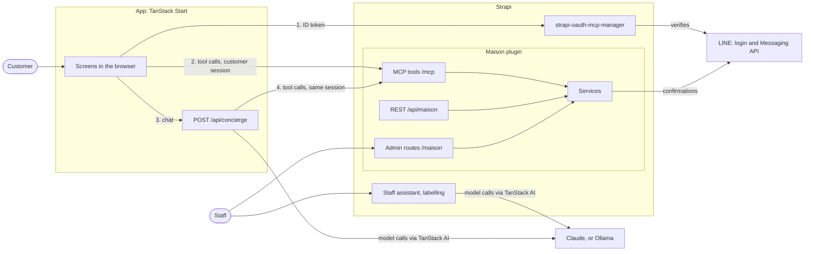

# How Maison works

This page describes the two halves of Maison, how they connect, and where TanStack AI is used. For the plugin's tools, routes and permissions, see [the plugin's README](../strapi/src/plugins/maison/README.md).

## The two halves

| Half | Folder | Built with | Runs on (local) |
| --- | --- | --- | --- |
| The customer app and the concierge | `app/` | TanStack Start (Router, Query, Form), TanStack AI, `@modelcontextprotocol/sdk` | http://localhost:3004 |
| The back end | `strapi/` | Strapi 5.57, the Maison plugin, Strapi's MCP server, strapi-oauth-mcp-manager, TanStack AI | http://localhost:1339 |

The app never reads Strapi's database. It talks to Strapi in three ways: MCP, one token exchange, and one REST read for the Home page text.

## Repository layout

| Path | What it is |
| --- | --- |
| `app/src/routes/` | File routes: Home, Collection, Product, My visits, Visit detail, Concierge, the not-found screen, `api/concierge`, and the three LINE mode proxy routes (`mcp`, `uploads.$`, `api/strapi-oauth-mcp-manager/oauth`) |
| `app/src/lib/` | Rules and clients: the LIFF session, the browser MCP client, booking rules, copy in English and Japanese, and `concierge/` for the server side of the concierge |
| `app/src/components/` | The phone frame, header, Agent view, booking sheet and form, and the concierge chat |
| `strapi/src/plugins/maison/` | The Maison plugin ([README](../strapi/src/plugins/maison/README.md)) |
| `strapi/src/api/home-page/` | The Home page single type, in English and Japanese |
| `scripts/`, `strapi/scripts/`, `app/scripts/` | `init-env`, `line-mode`, the tunnel, the QR code, the LINE stand-in and verify mock, and `npm run setup` |

## The MCP paths

Strapi's MCP server at `/mcp` accepts admin tokens. A customer's session is an admin token that oauth-mcp-manager issues for one LINE sign-in. Each tool checks a permission on that token. The services behind the tools hold the rules, so every path gives the same answers.

| Path | Caller | Credential | Tools |
| --- | --- | --- | --- |
| Browser to Strapi | The app's screens, in the customer's browser | The customer's session (`Authorization: Bearer mcp_at_...`) | `browse_collections`, `search_products`, `view_product`, `find_boutiques`, `request_appointment`, `my_appointments` |
| Concierge to Strapi | `POST /api/concierge`, on the app's server | The same customer session, passed on unchanged, with `x-maison-surface: concierge` | Every tool the session lists except `request_appointment` and `log_inquiry` |
| App server to Strapi, after a turn | The same route | The same customer session | `log_inquiry`, once per customer message |
| Staff agents | An agent with a staff admin token | The token's Maison permissions | `appointment_requests`, `confirm_appointment` |
| Ops agent | An agent with the ops token | "MCP: send appointment confirmations" only | `pending_confirmations`, `record_confirmation`, and the prompt `send_pending_confirmations` ([Ops tools](ops-tools.md)) |

- **The screens call Strapi from the browser on purpose.** This is the UX half of the idea, and the **Agent view** shows each call: its tool, arguments and result. TanStack Query holds the screen data, with one MCP call per screen load.
- **The concierge never holds a credential of its own.** It uses the customer's session, so a customer's concierge sees only what that customer may see.
- **The model is never offered `request_appointment`.** The customer books in the visit picker, which calls it from the browser with the customer's own session.
- **The staff assistant does not use `/mcp`.** It runs inside Strapi and calls the same tool handlers and services in process, with the admin's own role (see [The staff assistant](#the-staff-assistant)).
- **Errors** come back as `isError` results whose text is `{ "error": { "code", "message", "hint" } }`. Arguments the MCP SDK rejects come back as plain text that starts `Input validation error:`.

## Sign-in

1. **LIFF.** In local mode, LINE's LIFF mock signs in a demo customer (`?demoUser=U` and 32 hex characters signs in another one in that tab). Inside LINE, the real LIFF SDK does. Outside LINE, the app shows an "Open in LINE" page.
2. **The token exchange (RFC 8693).** The app posts the LINE ID token to `POST {STRAPI}/api/strapi-oauth-mcp-manager/oauth/token`, as a form:

   | Parameter | Value |
   | --- | --- |
   | `grant_type` | `urn:ietf:params:oauth:grant-type:token-exchange` |
   | `client_id` | `VITE_MAISON_CLIENT_ID`, the "Maison app" client that `npm run setup` made |
   | `subject_token` | the LINE ID token |
   | `subject_token_type` | `urn:ietf:params:oauth:token-type:id_token` |

3. **strapi-oauth-mcp-manager** asks LINE to verify the ID token for the configured channel, then answers `access_token` and `expires_in` (an hour by default). There is no refresh token.
4. **The session lives in memory.** The app keeps it in memory only, renews it when a call answers 401, and exchanges the ID token again when needed. `invalid_grant` (400) means LINE refused the token, so the customer signs in again. `temporarily_unavailable` (503) carries `Retry-After`.
5. **Local mode** points Strapi's `LINE_VERIFY_URL` at the verify mock on 4546, which accepts `valid.` followed by a LINE user ID. Strapi ignores `LINE_VERIFY_URL` when `NODE_ENV=production`.

One LINE client can be active in Strapi at a time. Tools never take the customer as an argument: the plugin asks oauth-mcp-manager who the session belongs to. Staff see customers masked, as `line:U4af...88`.

## TanStack AI

All model calls go through TanStack AI 0.68.0, and the TanStack AI packages are pinned to exact versions. No code in this repository imports the Vercel AI SDK, and none calls a model provider with `fetch`.

### The concierge, on the app's server

`app/src/routes/api/concierge.ts` is a TanStack Start server route. Its logic is in `app/src/lib/concierge/handle.ts`, which has tests that do not need Start.

1. **The request.** It needs `Authorization: Bearer mcp_at_...`, else 401. It takes a body up to 1 MB, the last 20 messages, and 1000 characters per user message. `chatParamsFromRequestBody` reads the run input. The route rebuilds each message's `parts` with `convertMessagesToModelMessages` and `modelMessagesToUIMessages`, because `chatParamsFromRequestBody` drops them.
2. **Our own MCP wrapper.** `lib/concierge/mcp-tools.ts` opens a `@modelcontextprotocol/sdk` `Client` to Strapi with the customer's header, lists the tools, and turns each one into a TanStack AI server tool: `toolDefinition({ name, description, inputSchema })` with Strapi's JSON Schema, and `.server()` calling `client.callTool`. It does not use `@tanstack/ai-mcp`, because that package throws a flat `Error` on `isError` and loses `{error:{code,message,hint}}`, which the chat's tool lines, prompt rule 6 and the automatic hand-off read.
3. **Local tools.** `resolve_date` is a server tool with a strict zod schema, on Tokyo's calendar. `choose_visit` is a **client tool**: `toolDefinition(...).client()` has no server function, so the model's call ends the run and the browser answers it.
4. **Wrappers.** `tool-wrappers.ts` fills in the conversation's `locale` when the model leaves it out, and hands the question to staff itself when a knowledge search comes back empty.
5. **The pre-check middleware.** `visit-check.ts` is a chat middleware. In `onToolPhaseComplete` it checks the product slugs of a `choose_visit` call with `find_boutiques`. On Strapi's `not_found` it answers the call with an error result, so the model fixes the slug and the browser never gets a picker that cannot work. `onBeforeToolCall` is not used, because 0.68 never runs it for a client tool.
6. **The run.** `chat()` gets the adapter, the system prompt built for this request (the calendar, the ten rules, the piece paragraph), the tools, `agentLoopStrategy: maxIterations(8)`, the request's abort signal, and `debug: false`. `toServerSentEventsResponse` returns it as a server-sent event stream. The route passes the request's `threadId` and `runId`, or the browser would make no follow-up request after a `choose_visit` answer.
7. **The extra pass as a second run.** When the customer asked to visit, a piece is known, and the reply made no `choose_visit` call (`asksToVisit` decides), the route runs a second `chat()` with only `resolve_date` and `choose_visit`. A middleware's `onConfig` sets Anthropic's `tool_choice` for each call: any tool first, then `choose_visit` until it was called. TanStack AI's `chat()` has no tool choice option, so this is how the call is forced. Ollama cannot force a call: there the pass only limits the tools, and the server logs when no picker came back. The second run's events are spliced into the first run's reply, so the browser shows one reply. It has at most 20 seconds, from the turn's 55-second budget.
8. **After the turn.** The route calls `log_inquiry` once per customer message, never per resume, with a 5 second timeout, then closes the MCP client.
9. **Time.** A turn may run 55 seconds, and the log may take 5 more, so the host must give the route 60 seconds ([Production](production.md)).

**The model** comes from `lib/concierge/model.ts`: `createAnthropicChat('claude-sonnet-5-5', key)` with `ANTHROPIC_API_KEY`, else `createOllamaChat(OLLAMA_MODEL, OLLAMA_BASE_URL)` with `think: false`.

### The concierge, in the browser

- **`useChat`** from `@tanstack/ai-react` runs the chat page (`components/concierge-chat.tsx`). `fetchServerSentEvents('/api/concierge', ...)` from `@tanstack/ai-client` is its connection. Its options are a function called on every send, so the session token, the `locale` and the `product` are fresh each time (`lib/chat-connection.ts`).
- **`choose_visit`** is passed to `useChat` as a client tool made from the server's own definition. Its answer comes from the **Book a visit** form: **Send request** calls `request_appointment` over MCP from the browser with the customer's session, then calls `addToolResult` with `{status:'requested', appointment}`. **Not now** answers `{status:'closed'}`. `ChatClient` then continues once per answer, never in a loop.
- **The chat** shows text, tool lines (`MCP · name ✓ 5 results`, `Local · choose_visit ✓ requested`), product cards, the visit picker, booking cards, hand-off notes and the empty-reply **Try again**.

### The staff assistant

The Maison plugin's server (`services/assistant.ts`, `controllers/assistant.ts`) streams one turn at `POST /maison/assistant/chat`.

- **Server:** `chatParamsFromRequestBody`, then `chat()` with the Anthropic adapter, seven read-only tools built with `toolDefinition(...).server()`, `maxIterations(6)` and `toServerSentEventsResponse`. A wrapper stream rebuilds each error from an allowlist, so staff read plain text and never the provider's own. The deadline is 90 seconds. The tools a chat has are those the admin's role allows.
- **Admin:** the drawer uses `useChat` and `fetchServerSentEvents` from `@tanstack/ai-react` and `@tanstack/ai-client`. Each admin's saved chats are stored through `/maison/conversations`.
- **The model** is `claude-sonnet-5-5` (`AI_CHAT_MODEL` changes it), with `AI_API_KEY`. The assistant never sends, confirms, answers, closes or relabels anything.

### Inquiry labelling

`services/labelling.ts` labels inquiries with `chat({ adapter, systemPrompts, messages, outputSchema })`, where `outputSchema` is a zod 4 schema (a Standard Schema) of the labels. The adapter is `createAnthropicChat('claude-haiku-4-5-20251001', key)`, or `createOllamaChat` for `AI_PROVIDER=ollama`. A cron job runs the sweep every minute. Failures are sorted by the HTTP status that `wrapFetch` reads: a refused key or no answer stops the sweep and counts against nothing, and a bad answer counts against the inquiry, which is parked after 5 attempts.

### The one cached dynamic import in Strapi

The plugin's server is CommonJS, and TanStack AI ships ES modules only. `server/src/ai/sdk.ts` is the only file that names the packages, and it loads them with a cached `await import()`. `scripts/check-esm-import.mjs` runs after every plugin build and fails if a built server bundle loads them statically. The admin bundle runs in the browser, so it imports them normally, in a chunk that loads on first use.

### TanStack AI APIs used, and where

| API | Package | Used in |
| --- | --- | --- |
| `chat()` | `@tanstack/ai` | Concierge route (two runs), staff assistant, labelling |
| `toolDefinition()`, `.server()` | `@tanstack/ai` | MCP tools as server tools, `resolve_date`, the assistant's tools |
| `toolDefinition()`, `.client()` | `@tanstack/ai` | `choose_visit` |
| `maxIterations()` | `@tanstack/ai` | Concierge (8, and 3 for the extra pass), assistant (6) |
| `chatParamsFromRequestBody()` | `@tanstack/ai` | Concierge route, assistant controller |
| `toServerSentEventsResponse()` | `@tanstack/ai` | Concierge route, assistant controller |
| Chat middleware: `onConfig`, `onToolPhaseComplete` | `@tanstack/ai` | The extra pass (`tool_choice`), the `choose_visit` pre-check |
| `outputSchema` | `@tanstack/ai` | Labelling |
| `wrapFetch` | `@tanstack/ai` | Labelling (reads the HTTP status) |
| `StreamProcessor`, `convertMessagesToModelMessages`, `modelMessagesToUIMessages` | `@tanstack/ai` | The concierge route and the live tests |
| `createAnthropicChat()` | `@tanstack/ai-anthropic` | Concierge, assistant, labelling |
| `createOllamaChat()` | `@tanstack/ai-ollama` | Concierge and labelling without a key |
| `useChat()`, `addToolResult` | `@tanstack/ai-react` | The concierge page, the assistant drawer |
| `fetchServerSentEvents()` | `@tanstack/ai-client` | The concierge page, the assistant drawer |

## The Maison plugin's layers

The plugin's services hold the rules: the catalog, opening hours, who may book what, and who sees a customer's LINE user ID. Four layers sit on them.

| Layer | Where | Used by |
| --- | --- | --- |
| Content types and the document middleware | `server/src/content-types`, `document-middleware.ts` | Every path: validation on create and update, and the LINE confirmation after an appointment is published |
| Domain rules | `server/src/domain` | Pure functions: hours, time, masking, references, fencing of customer text, validation, queues, messages |
| Services | `server/src/services` | The three interfaces below, the assistant and labelling |
| Interfaces | `server/src/mcp`, `server/src/rest`, `server/src/routes` | MCP tools on `/mcp`, REST on `/api/maison/...`, admin routes on `/maison/...` |

| Interface | Used by | Access |
| --- | --- | --- |
| MCP tools | The app, its concierge, staff agents | An admin token, or a customer session, with the tool's permission |
| REST API | Websites | The catalog: a role or API token. Bookings: a customer session |
| Admin routes | The Maison page, the Homepage widgets, the assistant drawer | An admin whose role holds the permission |

- **The Maison page** has three tabs, Requests, Questions and Inquiries, and a Demo data block. A drawer with the staff assistant is on every admin page.
- **Staff confirm a visit** with the board's **Confirm**, with `confirm_appointment`, or with **Publish** in the Content Manager. All three publish the appointment, and Strapi then sends the LINE confirmation itself.

## LINE mode

In LINE mode, the app runs inside LINE behind one public https origin. The app's server passes three Strapi paths on to Strapi (`/mcp`, the token endpoint and `/uploads`), and only a LINE build serves them. See [Running with LINE](line-setup.md).
