# Building an AI-powered chat with Strapi and MCP that brings customers and staff closer together

I wanted to know if I could give a small business an AI chat that its customers trust and its staff like working with. Not a chatbot added to a website. A chat that answers from the business's own information, books things for real, and hands over to a person the moment it should.

So I built one on Strapi. This post walks through the use case: the problem, what I was thinking, the tech stack, and how I solved it, step by step. Each step says where it lives in the code. The whole project is open source at [github.com/PaulBratslavsky/maison-tanstack](https://github.com/PaulBratslavsky/maison-tanstack). You can read along, run it, or give this post and the repo to Claude and ask it to explain or build any part for you.

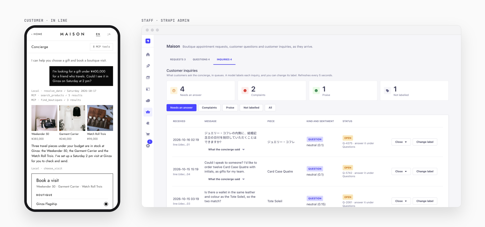

## The problem

Picture a small luxury shop with three boutiques. Call it Maison. Its customers message it on LINE, the chat app most people in Japan use every day. They ask the same things over and over. How do I care for the leather? Is the cabin case in stock in Ginza? Can I see it on Saturday?

Staff can't answer every message the moment it arrives. A generic chatbot answers fast, but it makes things up. A care tip that isn't true. A return policy that doesn't exist. A booking it can't actually make. And when a question really needs a person, the chatbot doesn't know how to step aside.

What I wanted was in between:

- Customers get fast, correct answers, and can book a visit without any back and forth.
- The AI only says what the business has written down, and only does what the business allows.
- Staff see every conversation, answer what the AI can't, and stay in control of anything that can't be undone.

## What I was thinking

Three ideas shaped everything.

**Keep the business in one place.** The catalog, the stock, the opening hours, the booking rules and the answers to common questions all belong in a CMS that staff already use. That's Strapi.

**Give the AI the same tools as the app.** Strapi 5 has an MCP server built in. MCP, the Model Context Protocol, is a standard way to give an AI model a set of tools it can call. If the app's screens and the AI both call the same Strapi tools, they follow the same rules, and the AI can't do anything the app couldn't. I started calling it going from UX to AX: from screens people tap to an agent that acts for them, using the same tools.

**Keep people in the loop on purpose.** The AI suggests and fills in. The customer confirms. Staff approve. And when the AI doesn't know, it hands over to a person, and that person's answer teaches it for next time.

Put together, those three ideas give this architecture.

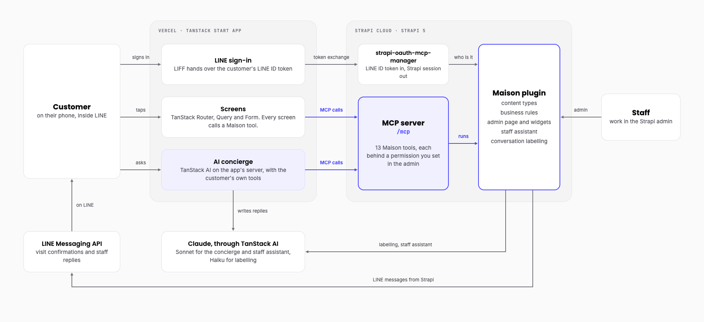

And here is one booking moving through it, from the customer's side: from a question in LINE to the confirmation back in LINE.

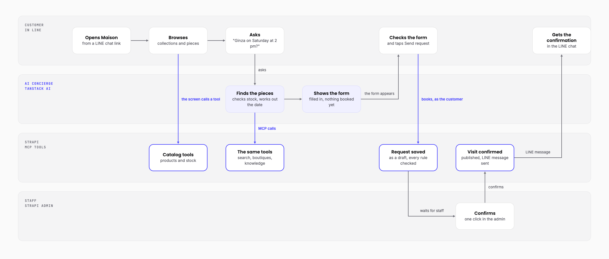

## The tech stack, and why I picked it

Most of this came with Strapi, its plugins or the TanStack libraries. I only wrote the shop.

| What I used | Why |
| --- | --- |
| Strapi 5 | Staff already edit content in it, and it has an MCP server, permissions, languages and draft and publish built in. One plugin holds all of Maison's rules. |
| strapi-oauth-mcp-manager | A community plugin that turns a LINE sign-in into a Strapi session, so customers never make an account. |
| TanStack Start | The customer app: screens and server routes in one React project, with TanStack Router, Query and Form. |
| TanStack AI | One library for every model call, in the app and inside Strapi. |
| Claude | Sonnet for the concierge and the staff assistant, Haiku for labelling. |
| LINE | Maison's customers already use it, for sign-in and for messages. |
| Strapi Cloud and Vercel | Hosting for Strapi and the app. |

You aren't tied to Claude, either. With TanStack AI the model is a setting, not code. The concierge and the labelling can both run on an open model on your own machine through Ollama. Only the staff assistant needs Claude.

## How I solved it

### Step 1: Model the business in Strapi

I started with content types, the same way you'd start any Strapi project: collections, products, boutiques, stock levels, visit appointments and product knowledge. Then three types for the conversation side: questions handed to staff, inquiries (every concierge conversation) and saved staff chats.

Two choices here did a lot of work later.

- **A booking is a draft until staff confirm it.** Strapi's draft and publish already means "not live yet" and "live", so a visit request is a draft, and a confirmed visit is published. No custom status field to keep in sync.
- **Everything customer-facing is in English and Japanese,** with Strapi's built-in i18n.

The knowledge entries matter most. They're short answers that staff write, about care, sizing, delivery, repairs, warranty and so on. The demo ships 16 of them. The AI will only ever answer from these.

**In the repo:** `strapi/src/plugins/maison/server/src/content-types/`, and the seed data in `strapi/src/plugins/maison/server/seed/`.

### Step 2: Put the rules in one Strapi plugin

The content types from step 1 already live in a plugin, and so does everything else Maison adds to Strapi. So before going further, here's what a plugin is and why I used one.

#### What a Strapi plugin is

A plugin is a folder of code that adds features to Strapi. It has two halves:

- `server/` runs inside Strapi. It holds data (content types), logic (services) and the ways to reach them (routes, and here, MCP tools).
- `admin/` adds screens to the Strapi admin, like pages and home page widgets.

Strapi's own Media Library and Internationalization are plugins too. You turn yours on with one line in `config/plugins.ts`:

```ts
maison: { enabled: true, resolve: 'src/plugins/maison' }
```

#### Why I used one

Everything Maison needs lives in one folder, and it plugs into what Strapi already has: the database, the MCP server, the admin and its permissions. I didn't have to build any of those. Delete the folder and you're back to a plain Strapi. Copy it into another project and that project gets Maison.

#### How the Maison plugin is put together

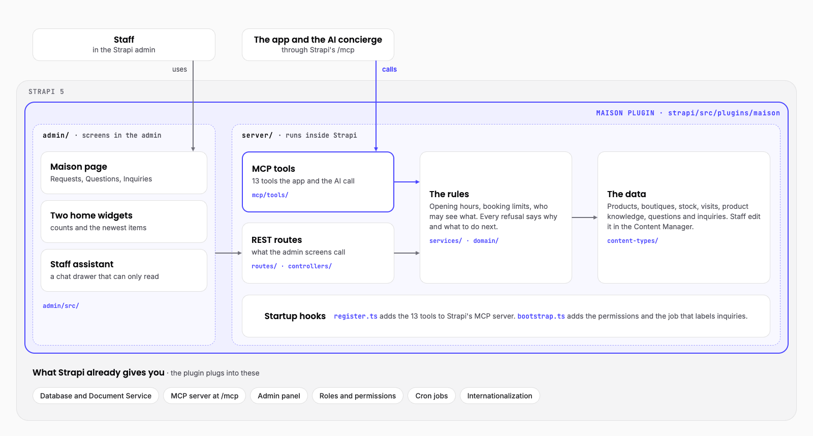

Read the diagram from the top.

- **Staff** work in the admin half: the Maison page, two home page widgets and the staff assistant. These screens call the plugin's REST routes.
- **The app and the AI concierge** call the MCP tools, through Strapi's `/mcp`.
- **Both paths end at the same rules.** A visit has to start at least 30 minutes from now. The boutique has to be open at that hour. A customer can hold at most three open requests and five open questions. Every refusal says why and what to do next, which matters a lot when an AI is the one reading it.
- **The rules read and write the data:** products, boutiques, stock, visits, product knowledge, questions and inquiries.
- **Two startup hooks connect it to Strapi.** `register.ts` adds the 13 tools to Strapi's MCP server. `bootstrap.ts` adds the permissions and the job that labels inquiries.

So a booking follows the same rules whether a person taps a button or the AI fills in the form.

**In the repo:** `strapi/src/plugins/maison/` is the plugin. `server/src/index.ts` and `admin/src/index.ts` are its two halves. The rules are in `server/src/services/` and `server/src/domain/`. `strapi/config/plugins.ts` turns it on.

### Step 3: Turn the rules into MCP tools

Turning on Strapi's MCP server is one setting in `config/server.ts`:

```ts
mcp: { enabled: true }
```

Then the plugin registers its tools. Maison has 13, in three groups:

| Who uses them | Tools |
| --- | --- |
| Customers (and the AI acting for them) | browse collections, search products, view a product, find boutiques, search knowledge, request a visit, list my visits, hand a question to staff, log a conversation |
| Staff | list visit requests, confirm a visit |
| An ops agent | list confirmations waiting to be sent, record that one was sent |

Each tool is small: a name, a description written for an AI to read, an input schema, and a handler that calls a service from step 2. And each tool needs a permission. Strapi won't register a tool without one.

That's where Strapi's permission system helps most. Callers reach `/mcp` with a token, and each token only sees the tools its permissions allow. A customer's session can't even see the staff tools. You change what a token can do by ticking boxes in the Strapi admin, with no code change and no redeploy.

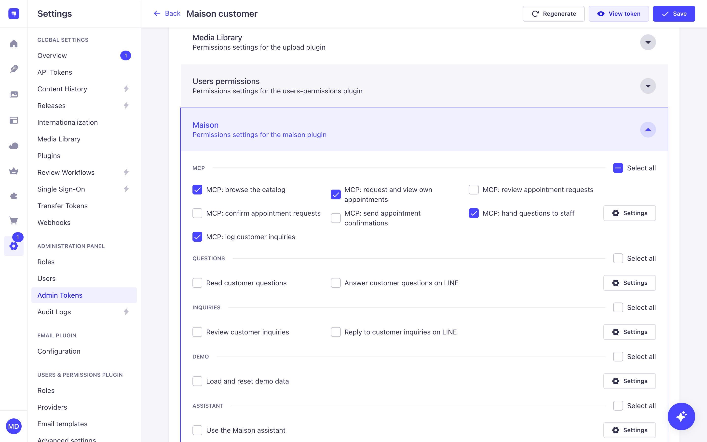

**In the repo:** `strapi/src/plugins/maison/server/src/mcp/tools/` (one file per tool), `server/src/register.ts` (where they're registered), and `server/src/bootstrap.ts` (the 13 permission actions).

### Step 4: Sign customers in with a plugin from the ecosystem

Customers shouldn't make an account. They're already signed in to LINE. I needed Strapi to trust LINE's sign-in and turn it into a Strapi session for `/mcp`.

I didn't write that part. A community plugin, [strapi-oauth-mcp-manager](https://github.com/PaulBratslavsky/strapi-oauth-mcp-manager), turns Strapi into an OAuth server for its MCP endpoint, and it can sign a customer in with LINE. The app hands it the LINE ID token, and gets back a one-hour Strapi session tied to the "Maison customer" permissions.

The important part for an AI app: inside every tool, Strapi knows who the customer is from that session. The AI never passes a customer ID as an argument. So no prompt, however clever, can book a visit for someone else.

**In the repo:** `strapi/config/plugins.ts` (the LINE sign-in setup) and `strapi/src/plugins/maison/server/src/services/identity.ts` (how a tool reads who the customer is).

### Step 5: Build the app's screens on the same tools

The customer app runs inside LINE, built with TanStack Start. Every screen gets its data by calling a Maison tool over MCP with the customer's own session. The home page calls `browse_collections`. A product page calls `view_product`. The booking form calls `request_appointment`.

I added a switch called Agent view that shows the real MCP calls behind each screen. It's the easiest way to show a client the idea: the app is already using the same tools an agent would.

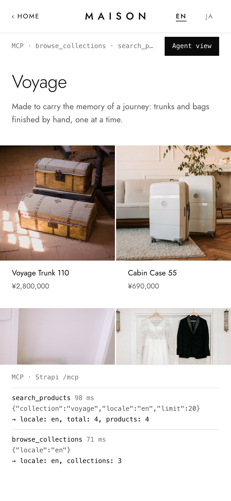

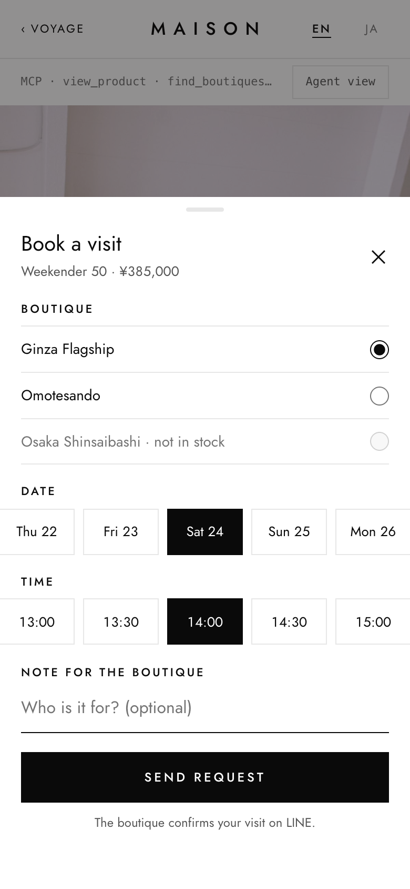

**In the repo:** `app/src/lib/mcp.ts` (the MCP client), `app/src/routes/` (the screens), and `app/src/components/agent-drawer.tsx` (Agent view).

### Step 6: Add the AI concierge

Now the chat. The concierge runs on the app's server with TanStack AI. On each turn it connects to Strapi's `/mcp` with the customer's own session, gets the customer's tools, and hands them to Claude. It sees exactly what the customer could see, and no more.

A few decisions made it trustworthy.

- **It answers from knowledge or hands over.** For care, sizing and the like, it searches the knowledge entries and answers only from what comes back. If nothing answers, the app hands the question to staff itself, and the customer gets a reference like Q-4821. That hand-off doesn't depend on the model choosing to do it.
- **It never books.** The concierge has no booking tool. It has a `choose_visit` tool that runs in the customer's browser. Calling it shows the booking form, already filled in with the boutique, day and time the customer asked for. The customer taps Send request. With TanStack AI this is a client tool: the model's call pauses the turn until the customer answers it.
- **Dates are a tool, not a guess.** Early on, a model turned "Saturday" into Friday. So the concierge got a small `resolve_date` tool, and it's told never to work out a date on its own.
- **It gets a fixed list of tools.** When I reviewed the finished project, I found Strapi was offering one extra development-only tool while running locally. The fix: the app now gives the model a named list of the customer tools, and nothing else.

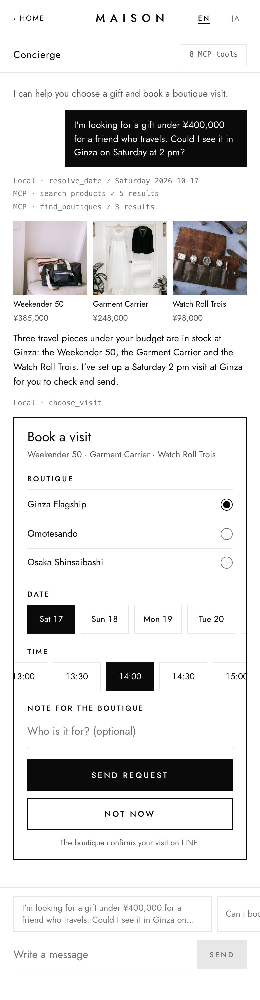

**In the repo:** `app/src/lib/concierge/` (the concierge: `handle.ts` runs a turn, `mcp-tools.ts` turns Strapi's tools into TanStack AI tools, `local-tools.ts` holds `resolve_date` and `choose_visit`), and `app/src/routes/api/concierge.ts` (the server route).

### Step 7: Give staff a place to work, inside the Strapi admin

Staff never leave the Strapi admin. The plugin adds to it, using Strapi's admin extension points.

- **A Maison page** with three tabs. Requests: visits waiting to be confirmed. Questions: what the concierge handed over. Inquiries: every conversation, sorted into queues.
- **Two widgets on the admin home page,** with counts and the newest visit requests and inquiries.
- **A chat assistant for staff** on every admin page. Staff ask "Which visits are waiting for staff?" or "Any complaints this week?" and get an answer with a table. It can only read, and it only gets the tools the staff member's role allows.

The assistant is a chat interface I built into the admin with TanStack AI's React hooks, the same library the concierge uses. A button at the bottom right of every admin page opens it, and it stays open while staff move between pages. Staff can start from quick questions, come back to saved chats, and see the list of tools their role allows. Each tool the assistant calls shows in the chat as a box staff can open, so they can see exactly what it looked up. Answers come back as Markdown, so a list of visits arrives as a table.

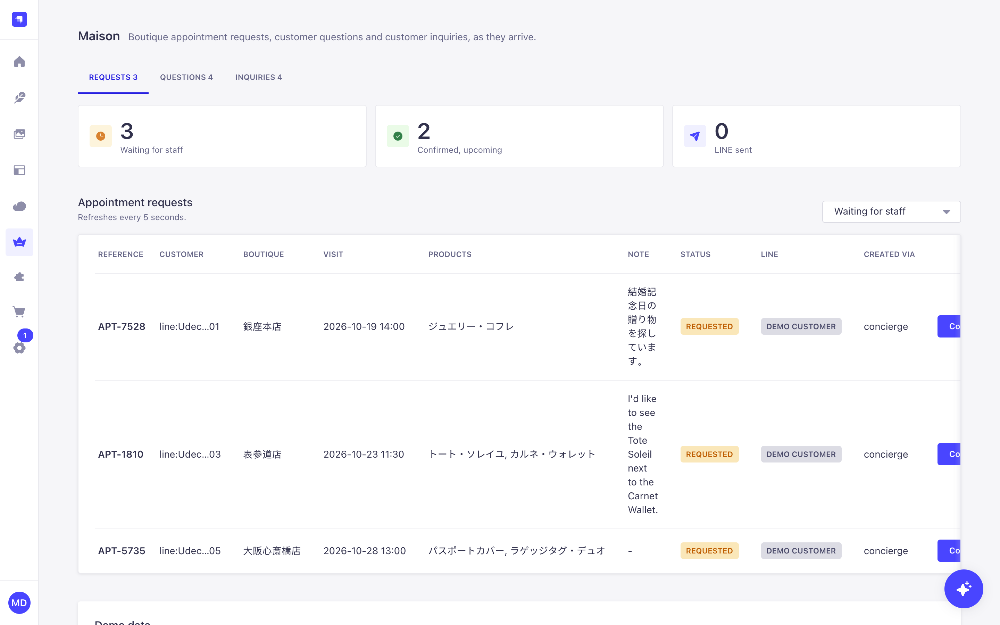

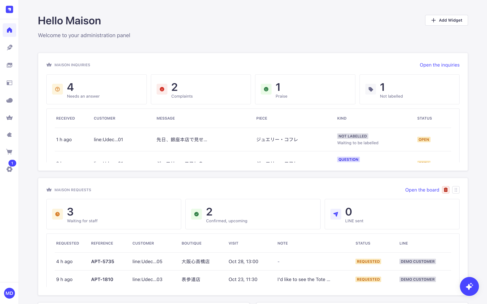

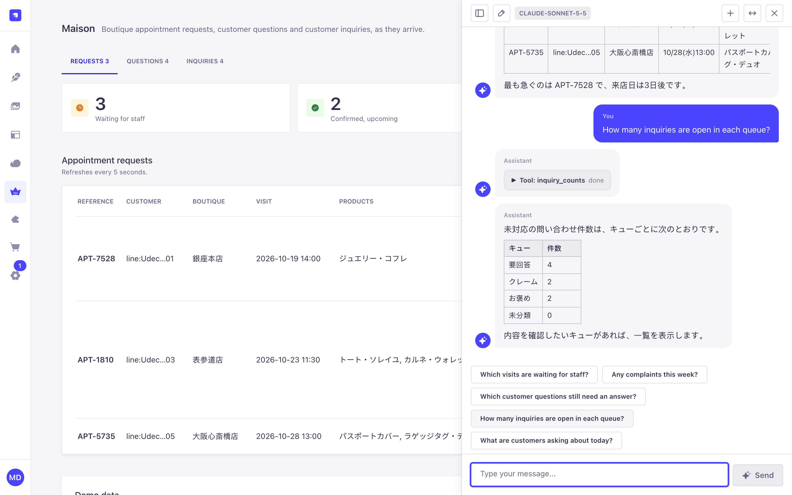

Confirming a visit is one click. It publishes the draft, and a Strapi document middleware sends the confirmation to the customer's LINE chat, in the language they booked in.

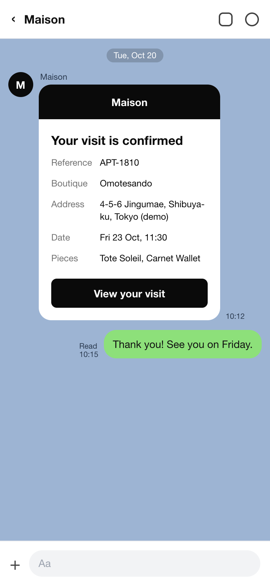

**In the repo:** `strapi/src/plugins/maison/admin/src/` (the page, the widgets, and `components/assistant/` for the staff chat), `server/src/document-middleware.ts` (the message sent when a visit is published), and `server/src/services/line-confirmations.ts`.

### Step 8: Close the loop between customers and staff

This is the step that brings customers and staff closer together.

Every concierge conversation is logged as an inquiry. Once a minute, a Strapi cron job asks Claude Haiku to label new ones. Each gets a kind (a question, a complaint, praise or something else), a sentiment, and whether the concierge actually answered it. Code, not the model, decides which queue each one goes in. A label a person sets always wins.

So staff open the Inquiries tab and see what needs them: unanswered questions first, then complaints, then praise worth a thank-you. They reply on LINE from the admin.

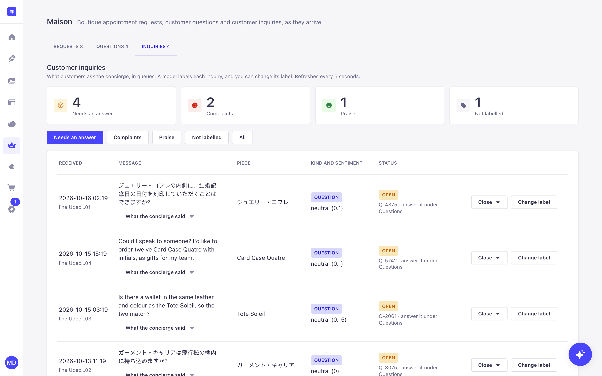

When staff answer a handed-over question, one tick saves that answer as new product knowledge. The next customer who asks the same thing gets the answer from the concierge directly. The concierge gets better every time staff help it.

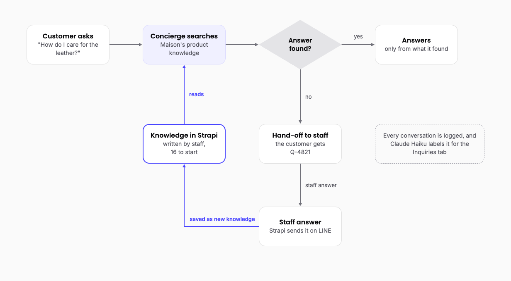

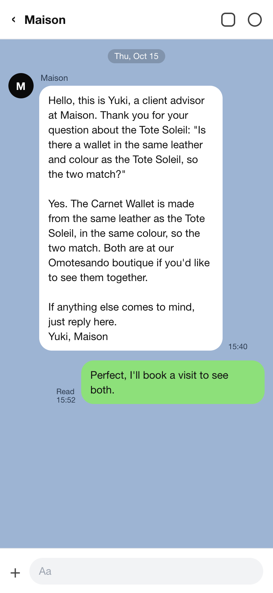

**In the repo:** `strapi/src/plugins/maison/server/src/services/labelling.ts` (labelling with Claude Haiku), `services/inquiries.ts` (the queues), and `services/questions.ts` (answering and saving knowledge).

## What I learned

- **Design tools around tasks, not data.** A website asks for a product. An agent works through a job: find a piece, check stock, pick a boutique, book. Write tool descriptions that say when to use the tool, and errors that say what to do next.
- **Take identity from sign-in, never from the model.** The tools read who the customer is from the session, so no prompt can act for someone else.
- **Keep anything you can't undo with people.** The AI fills in the form. The customer sends it. Staff confirm. Strapi sends the message.
- **Turn the AI's weak spots into tools.** Dates were one. Anything the model gets wrong twice is a candidate.
- **Do the important things in code.** Logging every conversation and handing over unanswered questions don't depend on the model deciding to.
- **Give the AI a fixed list of tools,** even when you trust the server.

## Use this post with your AI assistant

If you want to build something like this, open the repo with Claude (or any coding assistant) and give it this post. Here's where everything lives.

| Part | Where in the repo |
| --- | --- |
| Content types and seed data | `strapi/src/plugins/maison/server/src/content-types/`, `server/seed/` |
| Business rules | `strapi/src/plugins/maison/server/src/services/`, `server/src/domain/` |
| The 13 MCP tools | `strapi/src/plugins/maison/server/src/mcp/tools/` |
| Tool permissions | `strapi/src/plugins/maison/server/src/bootstrap.ts` |
| Turning on MCP | `strapi/config/server.ts` |
| LINE sign-in | `strapi/config/plugins.ts` |
| The app's screens | `app/src/routes/` |
| The app's MCP client | `app/src/lib/mcp.ts` |
| The concierge | `app/src/lib/concierge/`, `app/src/routes/api/concierge.ts` |
| The staff admin and assistant | `strapi/src/plugins/maison/admin/src/` |
| Conversation labelling | `strapi/src/plugins/maison/server/src/services/labelling.ts` |
| How it all fits | `docs/architecture.md` |
| Every decision and why | `docs/progress.md` |

Some questions to start with:

- "How does a tool in `mcp/tools/` reach a Strapi service, and how are its permissions checked?"
- "Walk me through a booking, from the concierge's reply to the confirmation in LINE."
- "Help me add a new MCP tool that lists a customer's past orders."
- "Help me adapt this to a restaurant that takes table bookings."

To run it on your laptop, follow the Quick start in the repo's README. You don't need a LINE account, and the concierge can run on a local model if you don't have a Claude key.

You can also connect your own AI client, such as Claude Desktop, to Strapi's `/mcp` endpoint with an admin token. It sees the tools that token's permissions allow, and nothing else. `docs/ops-tools.md` shows how.

If your business already runs on Strapi, most of this is already there. The rest is one plugin.
